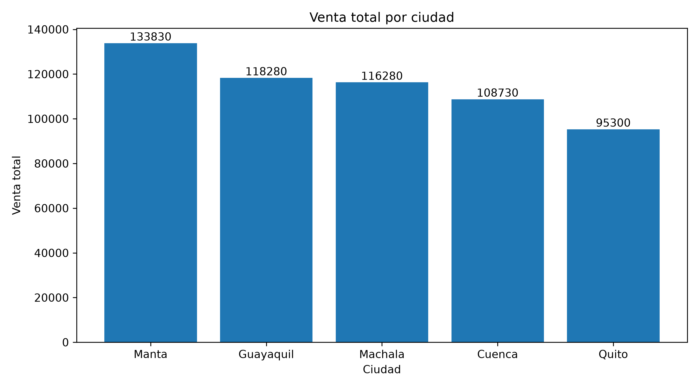
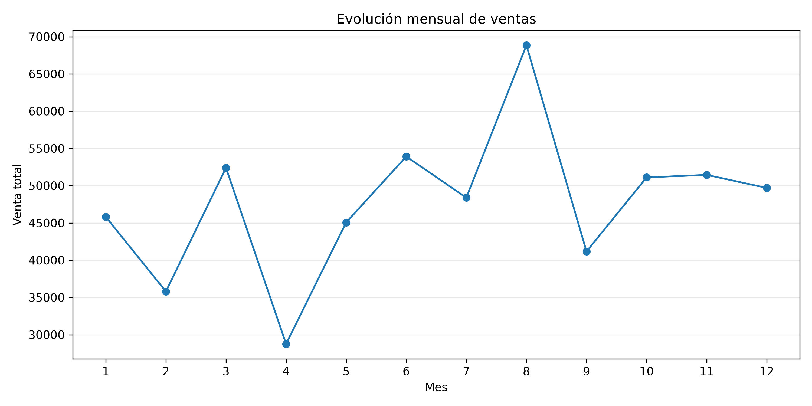

# Retail Sales & Inventory Analytics

Proyecto end-to-end de análisis de datos para un negocio minorista ficticio, enfocado en ventas, cumplimiento de objetivos e inventario.

El proyecto cubre un flujo completo de datos: generación de información sintética, control de calidad, limpieza con Python y pandas, almacenamiento en PostgreSQL, análisis con SQL, cálculo de KPIs, generación de reportes y creación automatizada de visualizaciones.

> **Nota:** todos los datos utilizados son sintéticos y fueron generados exclusivamente con fines educativos y de portafolio. No contienen información real de empresas, clientes o personas.

---

## Objetivo

Construir un pipeline de análisis reproducible que permita:

- Generar datos de ventas ficticios con problemas controlados de calidad.
- Detectar valores nulos, duplicados e inconsistencias.
- Limpiar y transformar información con pandas.
- Calcular métricas derivadas de ventas, cumplimiento y cobertura.
- Almacenar los datos procesados en PostgreSQL.
- Ejecutar análisis mediante SQL.
- Consultar PostgreSQL desde Python.
- Crear KPIs y rankings de negocio.
- Detectar automáticamente los mejores y peores resultados.
- Generar reportes CSV y gráficos reutilizables.
- Mantener credenciales fuera del código.
- Ejecutar el proyecto dentro de un entorno virtual reproducible.

---

## Pipeline de datos

```text
Datos sintéticos
      ↓
sales_raw.csv
      ↓
Control de calidad
      ↓
Limpieza y transformación con pandas
      ↓
sales_clean.csv
      ↓
PostgreSQL
      ↓
Consultas SQL
      ↓
Python + SQLAlchemy
      ↓
KPIs e insights
      ↓
Reportes CSV + visualizaciones
```

---

## KPIs principales

| KPI | Resultado |
|---|---:|
| Unidades vendidas | 2,643 |
| Venta total | $572,420 |
| Cumplimiento promedio | 74.67% |
| Registros que cumplen el target | 28.60% |

---

## Principales insights

- **Manta** presenta la mayor venta total: **$133,830**.
- **Nova Pro** es el producto con mayor venta total: **$180,160**.
- **Pulse A1** registra el mayor volumen de unidades vendidas.
- **Pulse A2** presenta el mayor cumplimiento promedio entre los productos: **83.82%**.
- **Machala** registra el mayor cumplimiento promedio entre las ciudades: **77.44%**.
- **Agosto** es el mes con mayor venta: **$68,850**.
- **Abril** es el mes con menor venta: **$28,760**.

La ciudad con mayor volumen de ventas no necesariamente es la que presenta mayor cumplimiento de objetivos, lo que demuestra la importancia de analizar diferentes KPIs antes de evaluar desempeño.

Debido a que el dataset es sintético, estos resultados demuestran el proceso analítico y no deben interpretarse como tendencias reales de mercado.

---

## Visualizaciones

### Venta total por ciudad



### Evolución mensual de ventas



---

## Tecnologías utilizadas

### Lenguajes y análisis

- Python 3.11
- SQL
- pandas
- NumPy

### Base de datos

- PostgreSQL
- psycopg
- SQLAlchemy

### Visualización

- Matplotlib

### Configuración y seguridad

- python-dotenv
- Variables de entorno
- `.gitignore`

### Control de versiones

- Git
- GitHub

---

## Estructura del proyecto

```text
retail-sales-analytics/
│
├── data/
│   ├── raw/
│   │   └── sales_raw.csv
│   │
│   └── processed/
│       └── sales_clean.csv
│
├── images/
│   ├── ventas_mensuales.png
│   └── ventas_por_ciudad.png
│
├── reports/
│   ├── kpis_generales.csv
│   ├── ventas_por_ciudad.csv
│   ├── ventas_por_mes.csv
│   └── ventas_por_producto.csv
│
├── sql/
│   └── analysis_queries.sql
│
├── src/
│   ├── __init__.py
│   ├── database.py
│   ├── generate_data.py
│   ├── check_data.py
│   ├── clean_data.py
│   ├── validate_data.py
│   ├── load_to_postgres.py
│   ├── query_postgres.py
│   └── business_analysis.py
│
├── .env.example
├── .gitignore
├── README.md
└── requirements.txt
```

El directorio `.venv/` se crea localmente para el entorno virtual, pero está excluido del repositorio mediante `.gitignore`.

---

## Flujo del proyecto

### 1. Generación de datos

`generate_data.py` crea un dataset sintético de ventas con aproximadamente 500 registros.

Además introduce intencionalmente algunos problemas de calidad para simular situaciones reales:

- valores nulos,
- registros duplicados,
- espacios innecesarios,
- diferencias entre mayúsculas y minúsculas,
- inconsistencias en nombres.

El resultado inicial se almacena en:

```text
data/raw/sales_raw.csv
```

---

### 2. Control de calidad

`check_data.py` realiza una inspección inicial del dataset y permite revisar:

- número de filas y columnas,
- tipos de datos,
- valores nulos,
- registros duplicados,
- estructura general de la información.

---

### 3. Limpieza y transformación

`clean_data.py` realiza el procesamiento principal del dataset.

Entre las transformaciones se incluyen:

- eliminación de duplicados,
- normalización de texto,
- tratamiento de valores faltantes,
- conversión de fechas,
- creación de año y mes,
- cálculo de venta total,
- cálculo de porcentaje de cumplimiento,
- creación de indicador de cumplimiento de target,
- creación de indicador de cobertura.

El dataset procesado se almacena en:

```text
data/processed/sales_clean.csv
```

---

### 4. Validación

`validate_data.py` comprueba que el dataset final:

- no contenga valores nulos,
- no contenga duplicados,
- tenga las columnas esperadas,
- conserve una estructura adecuada para el análisis.

---

### 5. Conexión con PostgreSQL

La configuración de base de datos está centralizada en:

```text
src/database.py
```

Este módulo contiene funciones reutilizables para crear conexiones con:

- SQLAlchemy
- psycopg

De esta forma, los demás scripts no repiten la configuración de conexión.

---

### 6. Carga de datos

`load_to_postgres.py`:

- crea la tabla `sales` si no existe,
- elimina los registros anteriores antes de una carga completa,
- inserta las 500 filas procesadas,
- confirma los cambios mediante una transacción.

La información se almacena en la base de datos:

```text
retail_sales_analytics
```

---

### 7. Análisis SQL

Las consultas principales se almacenan en:

```text
sql/analysis_queries.sql
```

El análisis incluye:

- ventas por ciudad,
- ventas por producto,
- unidades vendidas,
- cumplimiento promedio,
- comportamiento mensual.

---

### 8. Análisis de negocio

`business_analysis.py` consulta PostgreSQL y automatiza la generación de:

- KPIs generales,
- ranking de ciudades,
- ranking de productos,
- ventas mensuales,
- mejores y peores resultados,
- reportes CSV,
- visualizaciones.

Los resultados se almacenan automáticamente en:

```text
reports/
images/
```

---

# Instalación

## Requisitos previos

Para ejecutar el proyecto se necesita:

- Python 3.11 o compatible.
- PostgreSQL.
- Git.
- Una base de datos PostgreSQL llamada:

```text
retail_sales_analytics
```

Todos los comandos deben ejecutarse desde la raíz del proyecto.

---

## 1. Clonar el repositorio

```bash
git clone https://github.com/KleberL/retail-sales-analytics.git
cd retail-sales-analytics
```

---

## 2. Crear un entorno virtual

```bash
python -m venv .venv
```

El entorno virtual mantiene las dependencias del proyecto separadas de las librerías instaladas globalmente en el sistema.

---

## 3. Activar el entorno virtual

### Windows PowerShell

```powershell
.\.venv\Scripts\Activate.ps1
```

Cuando el entorno esté activo, la terminal mostrará:

```text
(.venv)
```

Si PowerShell bloquea la ejecución de `Activate.ps1`, puede habilitarse temporalmente para la sesión actual:

```powershell
Set-ExecutionPolicy -Scope Process -ExecutionPolicy Bypass
```

Luego volver a ejecutar:

```powershell
.\.venv\Scripts\Activate.ps1
```

El cambio mediante `-Scope Process` solo afecta la sesión actual de PowerShell.

### Windows CMD

```cmd
.venv\Scripts\activate.bat
```

### macOS / Linux

```bash
source .venv/bin/activate
```

---

## 4. Instalar dependencias

Con el entorno virtual activo:

```bash
python -m pip install -r requirements.txt
```

Las principales dependencias son:

```text
pandas==3.0.6
matplotlib==3.11.2
psycopg[binary]==3.3.8
SQLAlchemy==2.1.8
python-dotenv==1.2.4
```

Se utiliza `psycopg[binary]` para incluir los componentes necesarios para la conexión con PostgreSQL y facilitar la reproducibilidad del proyecto en entornos nuevos.

---

## 5. Configurar variables de entorno

Crear un archivo:

```text
.env
```

en la raíz del proyecto.

Puede utilizarse `.env.example` como referencia:

```text
DB_NAME=retail_sales_analytics
DB_USER=postgres
DB_PASSWORD=your_password
DB_HOST=localhost
DB_PORT=5432
```

Reemplazar `your_password` por la contraseña local de PostgreSQL.

El archivo `.env` está incluido en `.gitignore` y **no debe subirse a GitHub**.

---

# Ejecución

Con PostgreSQL disponible, las variables configuradas y el entorno virtual activo, ejecutar el pipeline desde la raíz del proyecto.

## 1. Generar los datos

```bash
python src/generate_data.py
```

## 2. Revisar la calidad inicial

```bash
python src/check_data.py
```

## 3. Limpiar y transformar los datos

```bash
python src/clean_data.py
```

## 4. Validar el dataset procesado

```bash
python src/validate_data.py
```

## 5. Cargar los datos en PostgreSQL

```bash
python -m src.load_to_postgres
```

## 6. Ejecutar una consulta desde Python

```bash
python -m src.query_postgres
```

## 7. Generar el análisis de negocio

```bash
python -m src.business_analysis
```

Este último proceso genera automáticamente los archivos de:

```text
reports/
images/
```

---

## Ejemplo de resultados

La consulta de rendimiento por producto genera resultados similares a:

| Producto | Unidades | Venta total | Cumplimiento promedio |
|---|---:|---:|---:|
| Nova Pro | 563 | $180,160 | 74.63% |
| Nova X2 | 506 | $116,560 | 71.88% |
| Pulse A2 | 486 | $97,200 | 83.82% |
| Nova X1 | 510 | $91,800 | 70.56% |
| Pulse A1 | 578 | $86,700 | 74.18% |

---

## Seguridad

El proyecto evita almacenar credenciales directamente dentro del código.

Las credenciales se cargan mediante:

```text
.env
      ↓
python-dotenv
      ↓
src/database.py
      ↓
PostgreSQL
```

`.env` está excluido mediante `.gitignore`.

El repositorio público solo incluye:

```text
.env.example
```

con valores de referencia.

---

## Reproducibilidad

El proyecto fue probado dentro de un entorno virtual limpio.

El flujo validado fue:

```text
Nuevo .venv
      ↓
pip install -r requirements.txt
      ↓
configuración de .env
      ↓
conexión PostgreSQL
      ↓
ejecución de módulos
      ↓
KPIs, reportes y gráficos
```

Esta prueba permitió detectar y corregir una dependencia incompleta de `psycopg`, reemplazándola por `psycopg[binary]` para facilitar la ejecución del proyecto en otras computadoras.

---

## Habilidades demostradas

Este proyecto demuestra conocimientos prácticos de:

- Python.
- pandas.
- limpieza y transformación de datos.
- análisis exploratorio.
- SQL.
- PostgreSQL.
- integración Python–PostgreSQL.
- SQLAlchemy.
- creación de KPIs.
- análisis de negocio.
- automatización de reportes.
- visualización con Matplotlib.
- variables de entorno.
- manejo seguro de credenciales.
- módulos y paquetes Python.
- entornos virtuales.
- Git y GitHub.
- documentación técnica.
- organización de proyectos de datos.
- reproducibilidad de entornos.

---

## Estado del proyecto

El proyecto continúa en desarrollo como parte de una ruta práctica de aprendizaje en análisis de datos, ciencia de datos e ingeniería de software.

Las siguientes mejoras se incorporarán progresivamente a medida que avance el proyecto.

---

## Autor

**Kleber Landívar**

Proyecto desarrollado como parte de un portafolio profesional de análisis de datos.