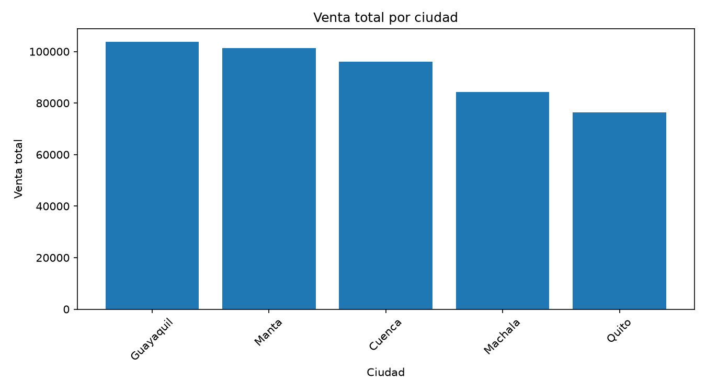
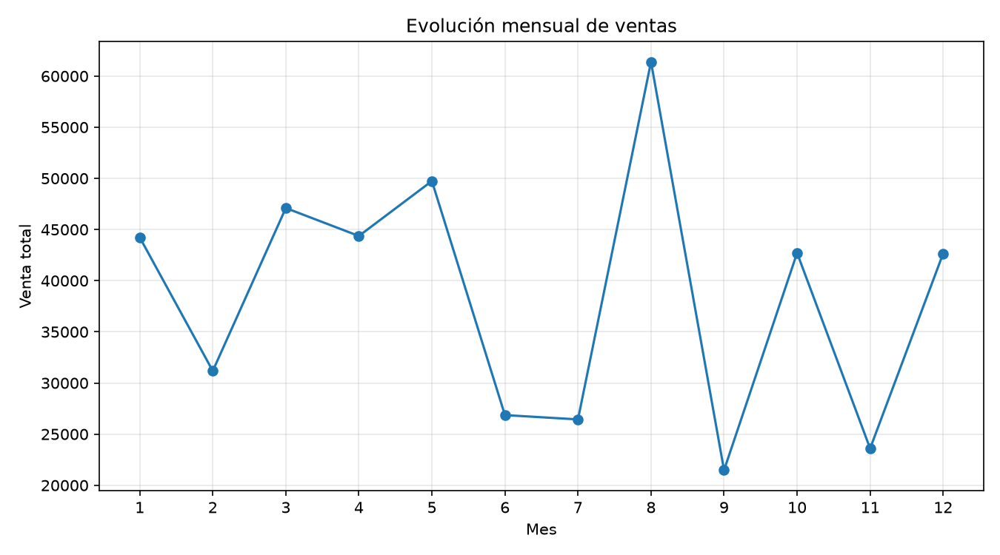

# Retail Sales & Inventory Analytics


End-to-end data analytics project that simulates a retail sales and inventory operation and transforms raw commercial data into business KPIs, reports and visual insights.

The project combines **Python, SQL and PostgreSQL** in a reproducible data pipeline with automated testing and continuous integration.

## Tech Stack

`Python` · `pandas` · `PostgreSQL` · `SQL` · `SQLAlchemy` · `psycopg` · `Matplotlib` · `unittest` · `Git` · `GitHub Actions`

---

## Key Results

| KPI | Result |
|---|---:|
| Total sales | **$461,760** |
| Units sold | **2,184** |
| Average target achievement | **61.69%** |
| Records meeting target | **23.40%** |
| Commercial coverage | **93.80%** |
| Automated tests | **15** |

### Main Insights

- **Guayaquil** generated the highest sales: **$103,760**
- **Nova Pro** was the highest-revenue product: **$129,280**
- **Pulse A1** had the highest number of units sold
- **Manta** achieved the highest commercial coverage: **98.17%**
- **August** was the strongest sales month: **$61,390**
- **September** recorded the lowest monthly sales: **$21,480**

> All data used in this project is synthetic and was created exclusively for learning and portfolio purposes.

---

## Visual Analysis

### Sales by City



### Monthly Sales Trend



---

## Business Problem

A retail operation needs to understand:

- Which cities generate the most revenue?
- Which products contribute the most sales?
- Are stores achieving their assigned targets?
- Which locations have sufficient commercial coverage?
- How do sales change throughout the year?
- Can the complete analysis be reproduced automatically?

This project builds a complete workflow to answer those questions.

---

## Data Pipeline

```text
Synthetic Data Generation
        ↓
Raw CSV
        ↓
Data Quality Inspection
        ↓
Cleaning & Transformation
        ↓
Processed CSV
        ↓
PostgreSQL
        ↓
SQL Analysis
        ↓
Business KPIs
        ↓
CSV Reports + Visualizations
        ↓
Automated Tests
        ↓
GitHub Actions
```

The complete pipeline can be executed with one command:

```bash
python -m src.run_pipeline
```

---

## Commercial Coverage Logic

Coverage is used to determine whether a store/product record has commercial presence through either sales or inventory.

```text
Units > 0
OR
Inventory > 0
        ↓
Coverage = 1
```

A record has no coverage only when:

```text
Units = 0
AND
Inventory = 0
        ↓
Coverage = 0
```

Current dataset:

```text
Coverage = 1 → 469 records
Coverage = 0 → 31 records

Total → 500 records
```

Result:

```text
Commercial coverage = 93.80%
```

---

## Synthetic Dataset

The project generates **500 base records** representing retail activity across several Ecuadorian cities.

Cities include:

- Guayaquil
- Quito
- Cuenca
- Machala
- Manta

Products include:

- Nova X1
- Nova X2
- Nova Pro
- Pulse A1
- Pulse A2

To make the data more realistic:

- approximately 20% of records may have zero sales,
- approximately 30% may have zero inventory.

The generator also introduces controlled data-quality issues such as:

- null values,
- duplicated rows,
- inconsistent capitalization,
- leading/trailing spaces,
- inconsistent store names.

Five duplicated records are intentionally added, producing an initial raw dataset of:

```text
505 rows
9 columns
```

After cleaning:

```text
500 rows
15 columns
```

---

## Data Cleaning

The cleaning process includes:

- duplicate removal,
- text normalization,
- null-value treatment,
- date conversion,
- year and month extraction,
- sales calculation,
- target-achievement calculation,
- target-status creation,
- commercial-coverage calculation.

The processed dataset is saved as:

```text
data/processed/sales_clean.csv
```

---

## PostgreSQL Integration

The cleaned dataset is loaded into PostgreSQL.

Database:

```text
retail_sales_analytics
```

Main table:

```text
sales
```

The project uses:

- `psycopg` for database operations,
- `SQLAlchemy` for analytical queries from Python,
- environment variables for database credentials.

---

## SQL Analysis

The project performs SQL analysis for:

- total revenue,
- units sold,
- sales by city,
- sales by product,
- monthly sales,
- target achievement,
- commercial coverage.

Main SQL queries are also stored in:

```text
sql/analysis_queries.sql
```

---

## Business Analysis

`business_analysis.py` retrieves processed data from PostgreSQL and generates:

- general KPIs,
- city rankings,
- product rankings,
- monthly results,
- coverage metrics,
- business insights,
- CSV reports,
- visualizations.

Example KPI:

```sql
ROUND(AVG(cobertura) * 100, 2) AS cobertura_general
```

---

## Modular Architecture

The project separates responsibilities into independent modules.

```text
src/
│
├── paths.py
│   └── Centralized project paths
│
├── database.py
│   └── PostgreSQL configuration and connections
│
├── generate_data.py
│   └── Synthetic dataset generation
│
├── check_data.py
│   └── Initial quality inspection
│
├── clean_data.py
│   └── Data cleaning and transformation
│
├── validate_data.py
│   └── Processed-data validation
│
├── load_to_postgres.py
│   └── PostgreSQL loading
│
├── query_postgres.py
│   └── Database queries
│
├── business_analysis.py
│   └── KPIs, reports and charts
│
└── run_pipeline.py
    └── Full pipeline orchestration
```

---

## Reusable Functions

The data generator was refactored into reusable functions:

```text
generate_dataset()
add_quality_issues()
save_dataset()
main()
```

The business-analysis module uses:

```text
get_kpis()
get_city_analysis()
get_product_analysis()
get_month_analysis()

print_results()
print_insights()

save_reports()
create_charts()

main()
```

Modules use:

```python
if __name__ == "__main__":
    main()
```

This prevents unwanted side effects when they are imported from other modules or tests.

---

## Project Structure

```text
retail-sales-analytics/
│
├── .github/
│   └── workflows/
│       └── tests.yml
│
├── data/
│   ├── raw/
│   │   └── sales_raw.csv
│   │
│   └── processed/
│       └── sales_clean.csv
│
├── images/
│   ├── ventas_mensuales.png
│   └── ventas_por_ciudad.png
│
├── reports/
│   ├── kpis_generales.csv
│   ├── ventas_por_ciudad.csv
│   ├── ventas_por_mes.csv
│   └── ventas_por_producto.csv
│
├── sql/
│   └── analysis_queries.sql
│
├── src/
│   ├── __init__.py
│   ├── business_analysis.py
│   ├── check_data.py
│   ├── clean_data.py
│   ├── database.py
│   ├── generate_data.py
│   ├── load_to_postgres.py
│   ├── paths.py
│   ├── query_postgres.py
│   ├── run_pipeline.py
│   └── validate_data.py
│
├── tests/
│   ├── __init__.py
│   ├── test_database.py
│   ├── test_data_quality.py
│   ├── test_generate_data.py
│   └── test_paths.py
│
├── .env.example
├── .gitignore
├── README.md
└── requirements.txt
```

---

## Automated Testing

The project currently includes **15 automated tests** using Python's `unittest`.

Tests validate:

### Project structure

- project root,
- data directories,
- output directories,
- required files.

### Database configuration

- correct environment-variable loading,
- missing configuration detection.

### Data quality

- exactly 500 processed records,
- no null values,
- no duplicates,
- expected columns,
- valid coverage values,
- correct coverage business rule.

### Data generation

- expected dataset dimensions,
- zero-sales and zero-inventory scenarios,
- reproducible output using the same random seed.

Run the complete test suite with:

```bash
python -m unittest discover -s tests -v
```

Current result:

```text
Ran 15 tests

OK
```

---

## Continuous Integration

The repository uses **GitHub Actions**.

Every push or Pull Request targeting `main` automatically:

```text
Checks out repository
        ↓
Sets up Python 3.11
        ↓
Installs dependencies
        ↓
Runs automated tests
        ↓
Pass / Fail
```

Workflow:

```text
.github/workflows/tests.yml
```

This helps detect regressions before changes are integrated into the main branch.

---

## Pipeline Automation

The complete project can be executed using:

```bash
python -m src.run_pipeline
```

The orchestrator automatically performs:

```text
Generate data
     ↓
Inspect quality
     ↓
Clean data
     ↓
Validate data
     ↓
Load PostgreSQL
     ↓
Query database
     ↓
Generate business analysis
     ↓
Run automated tests
```

A recent complete execution finished successfully in approximately:

```text
9.41 seconds
```

Execution time may vary depending on the environment.

---

## Error Handling

Database loading uses structured exception handling:

```text
try
except
finally
```

This ensures that:

- PostgreSQL errors are reported clearly,
- failures stop the pipeline,
- database cursors and connections are closed correctly.

The pipeline also stops immediately when a subprocess returns a failure code.

---

## Configuration & Security

Database credentials are never hardcoded in the source code.

Local credentials are stored in:

```text
.env
```

This file is excluded from Git using:

```text
.gitignore
```

The repository only contains:

```text
.env.example
```

Required variables:

```text
DB_NAME
DB_USER
DB_PASSWORD
DB_HOST
DB_PORT
```

Example:

```env
DB_NAME=retail_sales_analytics
DB_USER=postgres
DB_PASSWORD=your_password
DB_HOST=localhost
DB_PORT=5432
```

---

## Reproducibility

Dataset generation uses a fixed random seed:

```python
seed=42
```

This means:

```text
same code
+
same seed
=
same dataset
```

The project also includes:

- pinned dependencies,
- virtual-environment support,
- centralized paths,
- environment-variable validation,
- automated tests,
- continuous integration.

---

# Installation

## 1. Clone the Repository

```bash
git clone https://github.com/KleberL/retail-sales-analytics.git
cd retail-sales-analytics
```

## 2. Create a Virtual Environment

```bash
python -m venv .venv
```

### Windows PowerShell

```powershell
.\.venv\Scripts\Activate.ps1
```

If PowerShell blocks activation:

```powershell
Set-ExecutionPolicy -Scope Process -ExecutionPolicy Bypass
```

Then:

```powershell
.\.venv\Scripts\Activate.ps1
```

### macOS / Linux

```bash
source .venv/bin/activate
```

---

## 3. Install Dependencies

```bash
python -m pip install -r requirements.txt
```

---

## 4. Configure PostgreSQL

Create a PostgreSQL database named:

```text
retail_sales_analytics
```

Copy:

```text
.env.example
```

to:

```text
.env
```

and configure your local PostgreSQL credentials.

---

## 5. Run the Project

Recommended:

```bash
python -m src.run_pipeline
```

---

# Manual Execution

Each stage can also be executed independently.

Generate data:

```bash
python -m src.generate_data
```

Inspect raw data:

```bash
python -m src.check_data
```

Clean data:

```bash
python -m src.clean_data
```

Validate processed data:

```bash
python -m src.validate_data
```

Load PostgreSQL:

```bash
python -m src.load_to_postgres
```

Query PostgreSQL:

```bash
python -m src.query_postgres
```

Generate business analysis:

```bash
python -m src.business_analysis
```

Run tests:

```bash
python -m unittest discover -s tests -v
```

---

# Output Files

### Processed Data

```text
data/processed/sales_clean.csv
```

### Reports

```text
reports/kpis_generales.csv
reports/ventas_por_ciudad.csv
reports/ventas_por_producto.csv
reports/ventas_por_mes.csv
```

### Charts

```text
images/ventas_por_ciudad.png
images/ventas_mensuales.png
```

---

# Skills Demonstrated

This project demonstrates practical experience with:

- Python
- pandas
- SQL
- PostgreSQL
- data cleaning
- data transformation
- relational databases
- business KPIs
- commercial coverage analysis
- SQLAlchemy
- psycopg
- Matplotlib
- modular Python architecture
- reusable functions
- environment variables
- secure configuration
- `pathlib`
- exception handling
- automated testing
- mocking
- reproducible data generation
- pipeline automation
- subprocess orchestration
- Git
- GitHub
- branches
- Pull Requests
- GitHub Actions
- continuous integration
- technical documentation

---

# Development Workflow

Improvements were developed through dedicated Git branches and Pull Requests before being merged into `main`.

Examples include:

```text
feature/pipeline-timing
feature/realistic-coverage
refactor/script-entrypoints
```

This workflow allowed each improvement to be:

```text
Developed
    ↓
Tested
    ↓
Pushed
    ↓
Reviewed through Pull Request
    ↓
Validated by GitHub Actions
    ↓
Merged into main
```

---

# Project Status

**Portfolio-ready data analytics project.**

The project currently includes:

- complete end-to-end pipeline,
- synthetic but realistic commercial dataset,
- automated data cleaning,
- PostgreSQL integration,
- SQL business analysis,
- KPI calculation,
- commercial coverage analysis,
- automated reports,
- data visualizations,
- modular Python architecture,
- 15 automated tests,
- reproducible data generation,
- pipeline automation,
- error handling,
- secure environment configuration,
- GitHub Actions CI,
- branch and Pull Request workflow.

---

# Author

**Kleber Landívar**

Data Analytics Portfolio Project